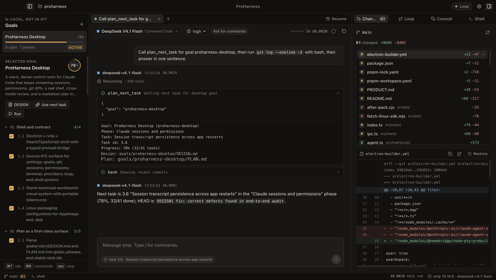

# ProHarness

ProHarness is a macOS desktop app for [Oh My Pi](https://omp.sh) (`omp`). It runs your existing omp setup (providers, logins, skills, extensions, `AGENTS.md`) in tabs, and adds a markdown plan plus an autonomous loop that works through the plan one reviewed commit at a time.

It does not have its own agent. Every session, implementer, reviewer, and consult is an `omp --mode rpc` process.



## Product docs

Read the [docs index](<docs/README.md>) for product rules, architecture, UI design, and development checks.
Read the [agent instructions](<AGENTS.md>) before repository changes.

## What it adds on top of omp

- **Tabs.** Each tab is a separate omp process. Switch model and reasoning effort per tab, queue follow-ups while it works (Return) or steer it (⌘Return), stop with Esc, compact, start fresh, or resume any omp session saved for the folder, including ones started in the terminal.
- **Approvals.** omp's approval prompts, `ask` tool questions and extension dialogs appear as native dialogs. The default chat mode lets edits run and asks before shell commands.
- **Plans.** `goals/<goal>/DESIGN.md` and a phased `PLAN.md` checklist. The rail shows progress, and agents read and update the plan through host tools (`plan_list`, `plan_read`, `plan_next_task`, `plan_complete_task`, `plan_add_note`, `git_status`).
- **Autonomous loop.** It picks the next open task, implements it, has a different model review the diff, sends findings back (with a cap on rounds), commits the code, and checks the task off.
- **Consult.** Ask any model a read-only question about the repo, optionally with the current diff attached.
- **Workbench.** Git changes with per-file diffs and restore, a real PTY shell, and the loop's live output.

### Remote workspaces over SSH

Click the workspace chip (or ⌘K → Change workspace), pick a host from `~/.ssh/config`, browse to a repo and open it. omp, git, the plan, the loop and the shell then all run on that machine, so it behaves like a local folder. Nothing is mounted: each operation goes over one multiplexed OpenSSH connection (`ControlPersist`), so a git status takes about 150 ms.

The remote host needs `git` and `omp` (`curl -fsSL https://omp.sh/install | sh`). Logins come from omp on that machine: run `omp` there and `/login`, or point a provider at a key file in `~/.omp/agent/models.yml`:

```yaml
providers:
  commandcode:
    apiKey: "!cat /home/ubuntu/.omp/agent/secrets/commandcode.key"
```

**Use this Mac's logins** (Settings → Workspace, per SSH host) shares your Mac's omp accounts with the host without copying keys there. ProHarness runs `omp auth-broker` on loopback and forwards it into the host over the existing SSH connection. The host's omp fetches short-lived access tokens from it when it starts and roughly hourly to renew; model requests go straight from the host to the provider, so streaming speed is unchanged (measured on devbox: about 3.0 s per one-line prompt either way). Long-lived refresh tokens stay on the Mac. Turning it off removes the token from the host. Since the Mac hands out the tokens, it has to be awake when a session starts and at each renewal.

Model choices are saved per host and checked against that host's catalog; a missing model falls back to the same model through another provider, with a note. Key or agent authentication is required; ProHarness never prompts for SSH passwords.

### goals/ never reaches git

The first time you create a goal or start the loop, ProHarness adds `/goals/` to `.git/info/exclude`. This is a local ignore: it leaves your shared `.gitignore` untouched. The Changes panel, review diffs and loop commits all leave `goals/` out, and the loop checks tasks off without committing the plan. If `goals/` was already tracked, run `git rm -r --cached goals` once.

## Requirements

- macOS 13 or later on Apple silicon.
- `omp` installed and logged in to at least one provider (`omp` → `/login`). ProHarness finds it on your login-shell `PATH`, or you can set the path in Settings.
- `git`.

## Run from source

```bash
pnpm install
pnpm dev          # Electron with hot reload
pnpm test         # unit + loop tests (no network)
pnpm test:live    # a real omp turn and a real one-task loop (DeepSeek V4.1 Flash builds, Claude Sonnet 5.5 reviews)
PROHARNESS_SSH_HOST=devbox npx vitest run tests/ssh-live.test.ts tests/ssh-loop-live.test.ts   # the same on an SSH host
pnpm dist:mac     # release/ProHarness-<version>-arm64.dmg and -mac.zip
```

Override with `PROHARNESS_LIVE_MODEL`, `PROHARNESS_LIVE_IMPLEMENTER` and `PROHARNESS_LIVE_REVIEWER` (all `provider/id`).

The packaged app is ad-hoc signed. On first launch, right-click the app and choose Open. To sign with a Developer ID, set `CSC_LINK` and `CSC_KEY_PASSWORD` and remove `identity: null` from `electron-builder.yml`.

## Models

The model list comes from `omp` (`get_available_models`), so it matches whatever you have logged in. Pinned models appear first in every picker; the defaults are Claude Opus/Sonnet/Haiku 5.5, GPT-6.1 Sol/Terra, GPT-6 Luna, and DeepSeek V4.1 Flash via Command Code. Change them in Settings.

| Role | Default |
| --- | --- |
| Chat tabs | omp's configured default (`modelRoles.default`) |
| Loop implementer | omp's configured default |
| Reviewer and consult | `anthropic/claude-sonnet-5-5` |

The loop refuses to start when the implementer and reviewer are the same model.

## Goal format

```
goals/
  checkout-redesign/
    DESIGN.md   # optional `status:` frontmatter, then the design
    PLAN.md     # phases and tasks
```

```md
## Phase 1 — Foundation
- [ ] **1.1** Add the cart service
- [ ] **1.2** Wire the API route
  - notes are indented bullets under a task
```

Use **New goal** in the rail to create a goal. With a brief, the active session writes the design and a phased plan for you.

## The loop

1. Preflight: the goal has open tasks, the folder is a git repo, the tree is clean outside `goals/`, and the reviewer differs from the implementer.
2. One persistent implementer omp session runs the whole loop, so later tasks keep the earlier context. It does not get the `plan_complete_task` tool.
3. Review: a fresh, read-only omp process (`read`, `grep` and `glob` only, no extensions) gets the task, the design, and the diff. It must end with `VERDICT: APPROVE` or `VERDICT: REQUEST_CHANGES`; anything else counts as a rejection.
4. Rejections go back to the implementer, up to the revision limit. After that the loop stops, leaves the diff in place, and commits nothing.
5. On approval: `git add -A` (with `goals/` excluded), one commit per task with `Reviewed-by:` in the message, then the task is checked off in PLAN.md.
6. If the tree changes between tasks, the loop stops rather than fold unrelated work into a commit.

**Implementer approvals** decides what the loop may do without asking. The default, *Never ask*, runs without prompts, but omp's critical-command guard still applies. Any prompt pauses the loop until you answer it.

## Architecture

```
src/main/omp/rpc.ts         JSONL transport: request/response ids, protocol v2 chunking, lifecycle
src/main/omp/agent.ts       one omp process: events → SessionEvent, dialogs, host tools, runTurn()
src/main/omp/translate.ts   pure mapping from omp payloads to view models
src/main/omp/env.ts         login-shell env (GUI apps get launchd's PATH) and omp discovery
src/main/host/              WorkspaceHost: LocalHost and SshHost (fs, exec, spawn over one control socket)
src/main/services/          sessions, task loop, review parsing, plan, git, consult, settings, terminal
src/renderer/               React + Zustand UI
```

Host tools are registered with `set_host_tools`, and a generated config overlay lets them run without a prompt. Dialogs are `extension_ui_request` frames answered through the UI broker. Each tab runs `--mode rpc-ui` so the `ask` tool works.

## Shortcuts

| Keys | Action |
| --- | --- |
| ⌘T / ⌘W | New / close tab |
| ⌘K | Command palette: actions, switch model, jump to a tab or goal |
| ⌘1 / ⌘2 | Toggle plan rail / workbench |
| ⌘3–⌘9, ⇧⌘[ ⇧⌘] | Switch tabs |
| ⌘J | Shell |
| Return / ⌘Return | Send or queue / steer while working |
| Esc | Stop the active turn; deny an approval |

## Troubleshooting

- **omp not ready**: open Settings and click Recheck. The error names the missing binary or the startup failure. Set the omp path explicitly if it lives outside your login `PATH`.
- **No models**: log in inside omp, then click Recheck.
- **Resume says another workspace**: omp records each session's folder, and ProHarness only resumes sessions from the current workspace.
